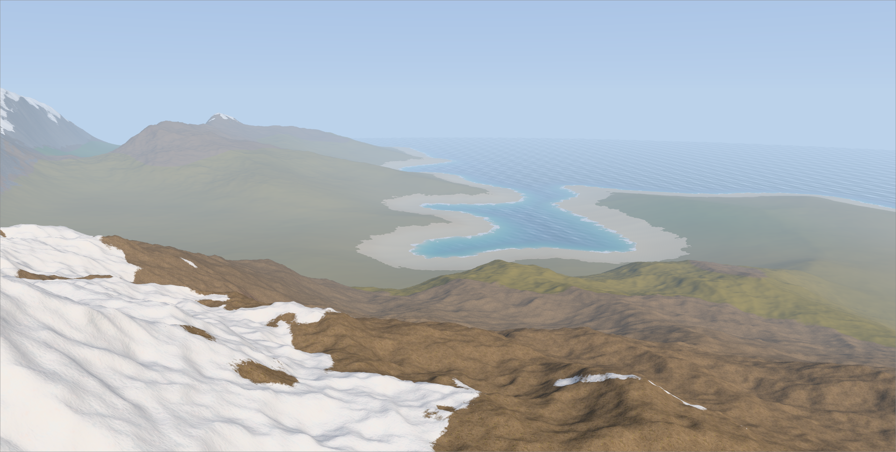
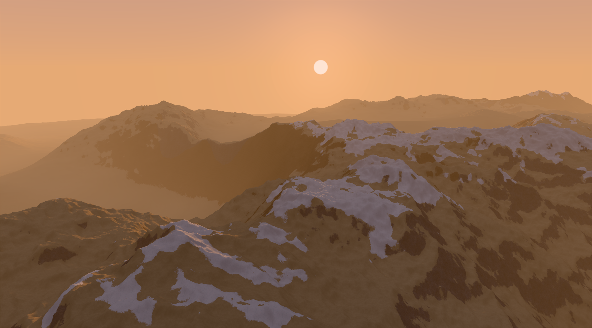
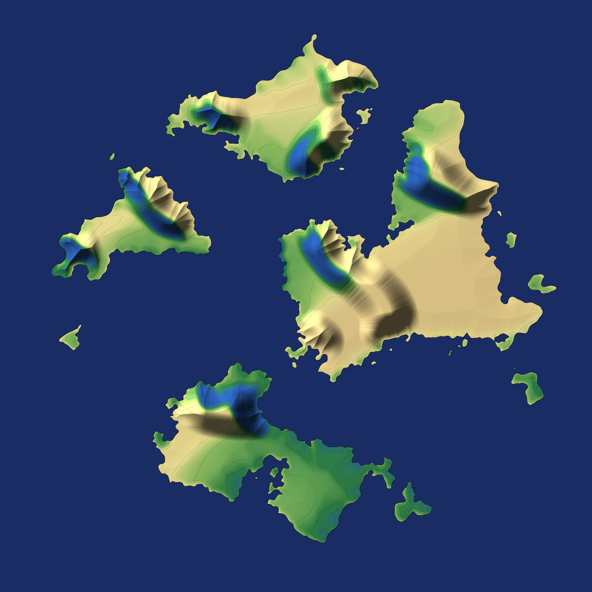
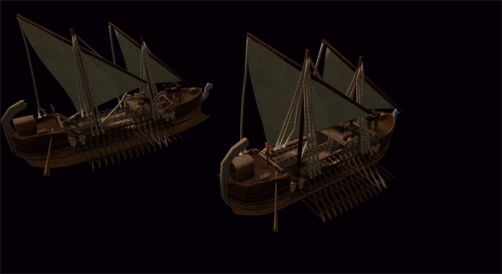
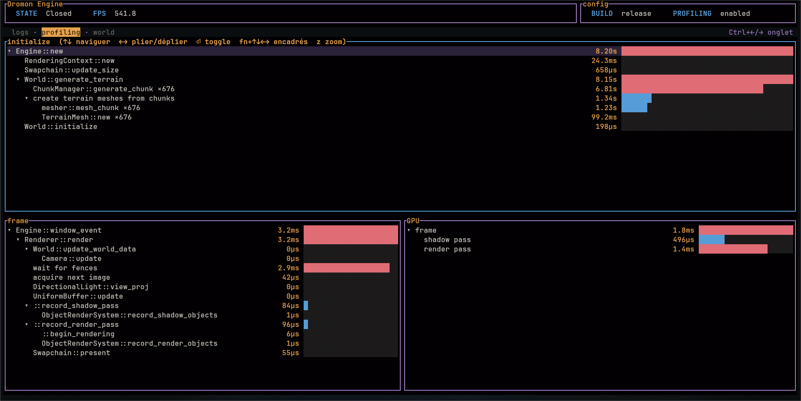

# Dromon

A 3D game engine written in Rust, built on top of Vulkan via the `ash` crate.

Dromon is a long-term personal project aimed at learning low-level graphics programming while building a capable and extensible engine. The goal is to eventually power small games with LLM-driven characters.

## Features

### Engine

- Low-level Vulkan renderer using dynamic rendering,
- Directional lighting with shadow mapping,
- Camera system,
- Input handling (keyboard/mouse),
- glTF model loading with textures,
- Custom GPU memory allocator,
- Built-in CPU and GPU profiling, streamed to the CLI over a Unix socket,
- Engine settings in .ron config files.

### Terrain generation and rendering

- precomputed macro world map (oceans and continents with coarse relief, temperature, wind, ocean currents and precipitation)
with png export,
- fine details generated on top of the macro map (SuperSimplex fBm),
- rule-based materials and biomes,
- volumetric terrain with super simplex noise and marching cubes,
- terrain streaming: asynchronous meshing, dynamic LOD, frustum culling,
- terrain texturing with albedo, height, normal and AO,
- oceans with several visual effects (waves, Fresnel reflections, depth-based absorption, shore foam),
- atmospheric fog,
- sun with day/night cycle, sky gradient and stars.

### CLI

- Companion terminal UI (ratatui) connecting to the engine over a Unix socket.
- Live status: engine state, FPS, build/profiling config.
- Real-time engine logs
- Init call tree, per-frame CPU breakdown, and GPU timestamps.
- Collapsible trees with proportional duration bars.

### Procedural terrain and world map

  Coastline with mountains
   
  

  Sunset over desert mountains
   
  

  Macro world map: relief and precipitation; rain shadows create deserts behind mountain ranges
   
  

### 3D models

  glTF models with textures
   
  

### Profiling CLI

  Profiling terminal UI
   
  

## Status

Active development. The engine foundations are in place; the current work focuses on world generation and rendering.
